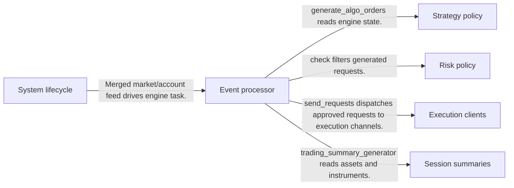
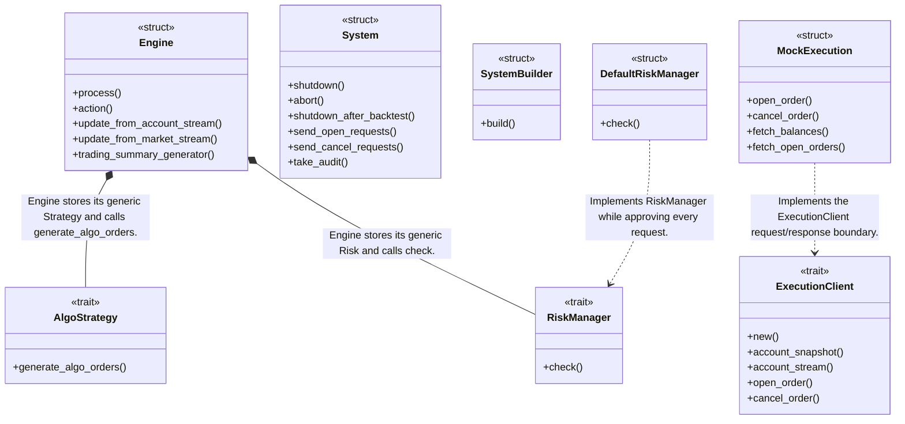
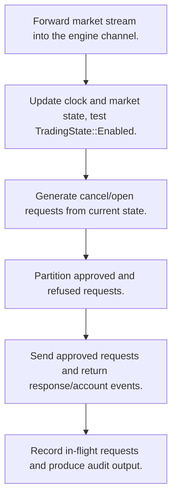
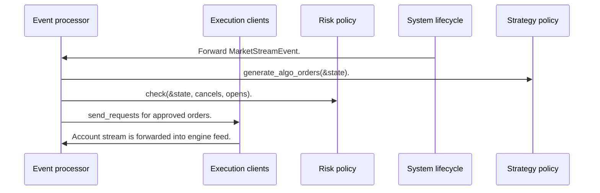

# Barter Rust: workflow, design and architecture

Updated: **2026-10-13**
Reviewed Git hash: `fff97c6925e2e08012f5243675e7057457f5d506`
Branch: `feature/ayu_develop`
Source diff SHA256: `e3b0c44298fc1c149afbf4c8996fb92427ae41e4649b934ca495991b7852b855`
Scope: **Event-driven engine** / Maintenance: **active**
Languages: Rust

[HTML edition](ayu-develop.html) / [Development](development.md) / [Historical validation](validation.md) / [Full system comparison](../../docs/index.html)

## Purpose and scope

Typed Rust trading system joining market/account events, strategy-generated order requests, risk approval, execution channels and session analytics.

## Features and support boundaries

Native = implemented here. Integration = supplied through a named host/API. Limited = material restriction. Not provided = evidenced scope exclusion. Unverified = support/absence not established. Not applicable = outside this artifact type.

| Capability | Status | Implementation and limits | Source |
|---|---|---|---|
| Backtesting | Native | System offers shutdown_after_backtest and mock execution with configurable time; source confirms replay/runtime primitives, not a historical-data downloader. | [System](../barter/src/system/mod.rs) ([L38](https://github.com/alexcwyu/barter-rs/blob/fff97c6925e2e08012f5243675e7057457f5d506/barter/src/system/mod.rs#L38)) / [MockExecution](../barter-execution/src/client/mock/mod.rs) ([L61](https://github.com/alexcwyu/barter-rs/blob/fff97c6925e2e08012f5243675e7057457f5d506/barter-execution/src/client/mock/mod.rs#L61)) |
| Live execution | Limited | ExecutionClient defines the asynchronous broker boundary; inspected concrete client is mock, so no claim of a verified live account path. | [ExecutionClient](../barter-execution/src/client/mod.rs) ([L24](https://github.com/alexcwyu/barter-rs/blob/fff97c6925e2e08012f5243675e7057457f5d506/barter-execution/src/client/mod.rs#L24)) / [MockExecution](../barter-execution/src/client/mock/mod.rs) ([L61](https://github.com/alexcwyu/barter-rs/blob/fff97c6925e2e08012f5243675e7057457f5d506/barter-execution/src/client/mock/mod.rs#L61)) |
| Paper trading | Native | MockExecution sends requests to the simulated exchange channel and awaits typed responses. | [MockExecution](../barter-execution/src/client/mock/mod.rs) ([L61](https://github.com/alexcwyu/barter-rs/blob/fff97c6925e2e08012f5243675e7057457f5d506/barter-execution/src/client/mock/mod.rs#L61)) |
| Event driven | Native | Typed event processor, strategy/risk/client traits and explicit request lifecycle are implemented. | [process](../barter/src/engine/mod.rs) ([L144](https://github.com/alexcwyu/barter-rs/blob/fff97c6925e2e08012f5243675e7057457f5d506/barter/src/engine/mod.rs#L144)) / [generate_algo_orders](../barter/src/engine/action/generate_algo_orders.rs) ([L46](https://github.com/alexcwyu/barter-rs/blob/fff97c6925e2e08012f5243675e7057457f5d506/barter/src/engine/action/generate_algo_orders.rs#L46)) / [AlgoStrategy](../barter/src/strategy/algo.rs) ([L10](https://github.com/alexcwyu/barter-rs/blob/fff97c6925e2e08012f5243675e7057457f5d506/barter/src/strategy/algo.rs#L10)) / [ExecutionClient](../barter-execution/src/client/mod.rs) ([L24](https://github.com/alexcwyu/barter-rs/blob/fff97c6925e2e08012f5243675e7057457f5d506/barter-execution/src/client/mod.rs#L24)) |
| Vectorized | Unverified | Not established by the inspected implementation boundaries; no absence or production claim is made. | Not applicable to this repository scope. |
| Order management | Native | Typed event processor, strategy/risk/client traits and explicit request lifecycle are implemented. | [process](../barter/src/engine/mod.rs) ([L144](https://github.com/alexcwyu/barter-rs/blob/fff97c6925e2e08012f5243675e7057457f5d506/barter/src/engine/mod.rs#L144)) / [generate_algo_orders](../barter/src/engine/action/generate_algo_orders.rs) ([L46](https://github.com/alexcwyu/barter-rs/blob/fff97c6925e2e08012f5243675e7057457f5d506/barter/src/engine/action/generate_algo_orders.rs#L46)) / [AlgoStrategy](../barter/src/strategy/algo.rs) ([L10](https://github.com/alexcwyu/barter-rs/blob/fff97c6925e2e08012f5243675e7057457f5d506/barter/src/strategy/algo.rs#L10)) / [ExecutionClient](../barter-execution/src/client/mod.rs) ([L24](https://github.com/alexcwyu/barter-rs/blob/fff97c6925e2e08012f5243675e7057457f5d506/barter-execution/src/client/mod.rs#L24)) |
| Order types | Limited | Native request vocabulary is Market/Limit with GTC/day/IOC/FOK; inspected MockExchange actually supports Market only and rejects Limit. TIF execution cannot be inferred from its enum. | [OrderKind](../barter-execution/src/order/mod.rs) ([L158](https://github.com/alexcwyu/barter-rs/blob/fff97c6925e2e08012f5243675e7057457f5d506/barter-execution/src/order/mod.rs#L158)) / [validate_order_kind_supported](../barter-execution/src/exchange/mock/mod.rs) ([L396](https://github.com/alexcwyu/barter-rs/blob/fff97c6925e2e08012f5243675e7057457f5d506/barter-execution/src/exchange/mock/mod.rs#L396)) |
| Multi venue | Limited | Exchange-keyed execution interface and exchange-indexed requests support multiple client boundaries; actual simultaneous live routing is not validated here. | [ExecutionClient](../barter-execution/src/client/mod.rs) ([L24](https://github.com/alexcwyu/barter-rs/blob/fff97c6925e2e08012f5243675e7057457f5d506/barter-execution/src/client/mod.rs#L24)) / [generate_algo_orders](../barter/src/engine/action/generate_algo_orders.rs) ([L46](https://github.com/alexcwyu/barter-rs/blob/fff97c6925e2e08012f5243675e7057457f5d506/barter/src/engine/action/generate_algo_orders.rs#L46)) |
| Crypto | Native | Spot and crypto derivative instrument models underpin the exchange-oriented engine. | [InstrumentKind](../barter-instrument/src/instrument/kind/mod.rs) ([L22](https://github.com/alexcwyu/barter-rs/blob/fff97c6925e2e08012f5243675e7057457f5d506/barter-instrument/src/instrument/kind/mod.rs#L22)) / [ExecutionClient](../barter-execution/src/client/mod.rs) ([L24](https://github.com/alexcwyu/barter-rs/blob/fff97c6925e2e08012f5243675e7057457f5d506/barter-execution/src/client/mod.rs#L24)) |
| Equities | Unverified | Not established by the inspected implementation boundaries; no absence or production claim is made. | Not applicable to this repository scope. |
| Futures | Limited | Future and Option contract model variants exist; this does not establish complete venue execution for these asset classes. | [InstrumentKind](../barter-instrument/src/instrument/kind/mod.rs) ([L22](https://github.com/alexcwyu/barter-rs/blob/fff97c6925e2e08012f5243675e7057457f5d506/barter-instrument/src/instrument/kind/mod.rs#L22)) |
| Options | Limited | Future and Option contract model variants exist; this does not establish complete venue execution for these asset classes. | [InstrumentKind](../barter-instrument/src/instrument/kind/mod.rs) ([L22](https://github.com/alexcwyu/barter-rs/blob/fff97c6925e2e08012f5243675e7057457f5d506/barter-instrument/src/instrument/kind/mod.rs#L22)) |
| Forex | Unverified | Not established by the inspected implementation boundaries; no absence or production claim is made. | Not applicable to this repository scope. |
| Strategy api | Native | Typed event processor, strategy/risk/client traits and explicit request lifecycle are implemented. | [process](../barter/src/engine/mod.rs) ([L144](https://github.com/alexcwyu/barter-rs/blob/fff97c6925e2e08012f5243675e7057457f5d506/barter/src/engine/mod.rs#L144)) / [generate_algo_orders](../barter/src/engine/action/generate_algo_orders.rs) ([L46](https://github.com/alexcwyu/barter-rs/blob/fff97c6925e2e08012f5243675e7057457f5d506/barter/src/engine/action/generate_algo_orders.rs#L46)) / [AlgoStrategy](../barter/src/strategy/algo.rs) ([L10](https://github.com/alexcwyu/barter-rs/blob/fff97c6925e2e08012f5243675e7057457f5d506/barter/src/strategy/algo.rs#L10)) / [ExecutionClient](../barter-execution/src/client/mod.rs) ([L24](https://github.com/alexcwyu/barter-rs/blob/fff97c6925e2e08012f5243675e7057457f5d506/barter-execution/src/client/mod.rs#L24)) |
| Optimization | Unverified | Not established by the inspected implementation boundaries; no absence or production claim is made. | Not applicable to this repository scope. |
| Machine learning | Unverified | Not established by the inspected implementation boundaries; no absence or production claim is made. | Not applicable to this repository scope. |
| Reinforcement learning | Unverified | Not established by the inspected implementation boundaries; no absence or production claim is made. | Not applicable to this repository scope. |
| Portfolio | Native | Asset/instrument state feeds TradingSummaryGenerator; session summaries are integrated with Engine. | [TradingSummaryGenerator](../barter/src/statistic/summary/mod.rs) ([L56](https://github.com/alexcwyu/barter-rs/blob/fff97c6925e2e08012f5243675e7057457f5d506/barter/src/statistic/summary/mod.rs#L56)) / [Engine](../barter/src/engine/mod.rs) ([L106](https://github.com/alexcwyu/barter-rs/blob/fff97c6925e2e08012f5243675e7057457f5d506/barter/src/engine/mod.rs#L106)) |
| Risk management | Limited | Native pluggable approval/refusal checks, but DefaultRiskManager approves all requests without checks. | [RiskManager](../barter/src/risk/mod.rs) ([L24](https://github.com/alexcwyu/barter-rs/blob/fff97c6925e2e08012f5243675e7057457f5d506/barter/src/risk/mod.rs#L24)) / [DefaultRiskManager](../barter/src/risk/mod.rs) ([L100](https://github.com/alexcwyu/barter-rs/blob/fff97c6925e2e08012f5243675e7057457f5d506/barter/src/risk/mod.rs#L100)) / [generate_algo_orders](../barter/src/engine/action/generate_algo_orders.rs) ([L46](https://github.com/alexcwyu/barter-rs/blob/fff97c6925e2e08012f5243675e7057457f5d506/barter/src/engine/action/generate_algo_orders.rs#L46)) |
| Performance analytics | Native | Asset/instrument state feeds TradingSummaryGenerator; session summaries are integrated with Engine. | [TradingSummaryGenerator](../barter/src/statistic/summary/mod.rs) ([L56](https://github.com/alexcwyu/barter-rs/blob/fff97c6925e2e08012f5243675e7057457f5d506/barter/src/statistic/summary/mod.rs#L56)) / [Engine](../barter/src/engine/mod.rs) ([L106](https://github.com/alexcwyu/barter-rs/blob/fff97c6925e2e08012f5243675e7057457f5d506/barter/src/engine/mod.rs#L106)) |
| Historical data | Unverified | Not established by the inspected implementation boundaries; no absence or production claim is made. | Not applicable to this repository scope. |
| Streaming data | Native | Market/account streams feed engine events; optional audit snapshot/update channels expose the run. | [init_internal](../barter/src/system/builder.rs) ([L340](https://github.com/alexcwyu/barter-rs/blob/fff97c6925e2e08012f5243675e7057457f5d506/barter/src/system/builder.rs#L340)) / [System](../barter/src/system/mod.rs) ([L38](https://github.com/alexcwyu/barter-rs/blob/fff97c6925e2e08012f5243675e7057457f5d506/barter/src/system/mod.rs#L38)) |
| Persistence | Unverified | Not established by the inspected implementation boundaries; no absence or production claim is made. | Not applicable to this repository scope. |
| Data pipeline | Unverified | Not established by the inspected implementation boundaries; no absence or production claim is made. | Not applicable to this repository scope. |
| Web ui | Unverified | Not established by the inspected implementation boundaries; no absence or production claim is made. | Not applicable to this repository scope. |
| Cli | Unverified | Not established by the inspected implementation boundaries; no absence or production claim is made. | Not applicable to this repository scope. |
| Monitoring | Native | Market/account streams feed engine events; optional audit snapshot/update channels expose the run. | [init_internal](../barter/src/system/builder.rs) ([L340](https://github.com/alexcwyu/barter-rs/blob/fff97c6925e2e08012f5243675e7057457f5d506/barter/src/system/builder.rs#L340)) / [System](../barter/src/system/mod.rs) ([L38](https://github.com/alexcwyu/barter-rs/blob/fff97c6925e2e08012f5243675e7057457f5d506/barter/src/system/mod.rs#L38)) |
| Extension api | Native | Typed event processor, strategy/risk/client traits and explicit request lifecycle are implemented. | [process](../barter/src/engine/mod.rs) ([L144](https://github.com/alexcwyu/barter-rs/blob/fff97c6925e2e08012f5243675e7057457f5d506/barter/src/engine/mod.rs#L144)) / [generate_algo_orders](../barter/src/engine/action/generate_algo_orders.rs) ([L46](https://github.com/alexcwyu/barter-rs/blob/fff97c6925e2e08012f5243675e7057457f5d506/barter/src/engine/action/generate_algo_orders.rs#L46)) / [AlgoStrategy](../barter/src/strategy/algo.rs) ([L10](https://github.com/alexcwyu/barter-rs/blob/fff97c6925e2e08012f5243675e7057457f5d506/barter/src/strategy/algo.rs#L10)) / [ExecutionClient](../barter-execution/src/client/mod.rs) ([L24](https://github.com/alexcwyu/barter-rs/blob/fff97c6925e2e08012f5243675e7057457f5d506/barter-execution/src/client/mod.rs#L24)) |
| Native acceleration | Native | Engine and asynchronous request lifecycle are compiled Rust; no comparative speed claim. | [Engine](../barter/src/engine/mod.rs) ([L106](https://github.com/alexcwyu/barter-rs/blob/fff97c6925e2e08012f5243675e7057457f5d506/barter/src/engine/mod.rs#L106)) / [ExecutionClient](../barter-execution/src/client/mod.rs) ([L24](https://github.com/alexcwyu/barter-rs/blob/fff97c6925e2e08012f5243675e7057457f5d506/barter-execution/src/client/mod.rs#L24)) |
| Distributed execution | Unverified | Not established by the inspected implementation boundaries; no absence or production claim is made. | Not applicable to this repository scope. |

## System components

| Component | Responsibility | Source |
|---|---|---|
| System lifecycle | Builds tasks and channels and owns shutdown/audit access. | [SystemBuilder](../barter/src/system/builder.rs) ([L101](https://github.com/alexcwyu/barter-rs/blob/fff97c6925e2e08012f5243675e7057457f5d506/barter/src/system/builder.rs#L101)) / [init_internal](../barter/src/system/builder.rs) ([L340](https://github.com/alexcwyu/barter-rs/blob/fff97c6925e2e08012f5243675e7057457f5d506/barter/src/system/builder.rs#L340)) / [System](../barter/src/system/mod.rs) ([L38](https://github.com/alexcwyu/barter-rs/blob/fff97c6925e2e08012f5243675e7057457f5d506/barter/src/system/mod.rs#L38)) |
| Event processor | Dispatches events, gates trading and coordinates order generation. | [Engine](../barter/src/engine/mod.rs) ([L106](https://github.com/alexcwyu/barter-rs/blob/fff97c6925e2e08012f5243675e7057457f5d506/barter/src/engine/mod.rs#L106)) / [process](../barter/src/engine/mod.rs) ([L144](https://github.com/alexcwyu/barter-rs/blob/fff97c6925e2e08012f5243675e7057457f5d506/barter/src/engine/mod.rs#L144)) / [generate_algo_orders](../barter/src/engine/action/generate_algo_orders.rs) ([L46](https://github.com/alexcwyu/barter-rs/blob/fff97c6925e2e08012f5243675e7057457f5d506/barter/src/engine/action/generate_algo_orders.rs#L46)) |
| Strategy policy | Generates open/cancel request iterators from state. | [AlgoStrategy](../barter/src/strategy/algo.rs) ([L10](https://github.com/alexcwyu/barter-rs/blob/fff97c6925e2e08012f5243675e7057457f5d506/barter/src/strategy/algo.rs#L10)) |
| Risk policy | Approves/refuses strategy requests; default approves all. | [RiskManager](../barter/src/risk/mod.rs) ([L24](https://github.com/alexcwyu/barter-rs/blob/fff97c6925e2e08012f5243675e7057457f5d506/barter/src/risk/mod.rs#L24)) / [DefaultRiskManager](../barter/src/risk/mod.rs) ([L100](https://github.com/alexcwyu/barter-rs/blob/fff97c6925e2e08012f5243675e7057457f5d506/barter/src/risk/mod.rs#L100)) |
| Execution clients | Executes typed requests and returns account/order responses. | [ExecutionClient](../barter-execution/src/client/mod.rs) ([L24](https://github.com/alexcwyu/barter-rs/blob/fff97c6925e2e08012f5243675e7057457f5d506/barter-execution/src/client/mod.rs#L24)) / [MockExecution](../barter-execution/src/client/mock/mod.rs) ([L61](https://github.com/alexcwyu/barter-rs/blob/fff97c6925e2e08012f5243675e7057457f5d506/barter-execution/src/client/mock/mod.rs#L61)) / [validate_order_kind_supported](../barter-execution/src/exchange/mock/mod.rs) ([L396](https://github.com/alexcwyu/barter-rs/blob/fff97c6925e2e08012f5243675e7057457f5d506/barter-execution/src/exchange/mock/mod.rs#L396)) |
| Session summaries | Computes session analytics from instrument and asset states. | [TradingSummaryGenerator](../barter/src/statistic/summary/mod.rs) ([L56](https://github.com/alexcwyu/barter-rs/blob/fff97c6925e2e08012f5243675e7057457f5d506/barter/src/statistic/summary/mod.rs#L56)) |

## Architecture and component boundaries

The component view summarizes inspected responsibility boundaries. Arrows identify the documented API/data dependencies; this is not a deployment-readiness claim.

- Merged market/account feed drives engine task.: [init_internal](../barter/src/system/builder.rs) ([L340](https://github.com/alexcwyu/barter-rs/blob/fff97c6925e2e08012f5243675e7057457f5d506/barter/src/system/builder.rs#L340))
- generate_algo_orders reads engine state.: [generate_algo_orders](../barter/src/engine/action/generate_algo_orders.rs) ([L46](https://github.com/alexcwyu/barter-rs/blob/fff97c6925e2e08012f5243675e7057457f5d506/barter/src/engine/action/generate_algo_orders.rs#L46))
- check filters generated requests.: [generate_algo_orders](../barter/src/engine/action/generate_algo_orders.rs) ([L46](https://github.com/alexcwyu/barter-rs/blob/fff97c6925e2e08012f5243675e7057457f5d506/barter/src/engine/action/generate_algo_orders.rs#L46))
- send_requests dispatches approved requests to execution channels.: [generate_algo_orders](../barter/src/engine/action/generate_algo_orders.rs) ([L46](https://github.com/alexcwyu/barter-rs/blob/fff97c6925e2e08012f5243675e7057457f5d506/barter/src/engine/action/generate_algo_orders.rs#L46))
- trading_summary_generator reads assets and instruments.: [TradingSummaryGenerator](../barter/src/statistic/summary/mod.rs) ([L56](https://github.com/alexcwyu/barter-rs/blob/fff97c6925e2e08012f5243675e7057457f5d506/barter/src/statistic/summary/mod.rs#L56)) / [Engine](../barter/src/engine/mod.rs) ([L106](https://github.com/alexcwyu/barter-rs/blob/fff97c6925e2e08012f5243675e7057457f5d506/barter/src/engine/mod.rs#L106))

## Design decisions

| Decision | Rationale | Tradeoff | Evidence |
|---|---|---|---|
| Split synchronous policy from asynchronous channels. | Processor handles events and decisions while runtime forwards I/O into the central feed. | Channel and audit configuration determine run behavior; asynchronous I/O is not distributed execution. | [process](../barter/src/engine/mod.rs) ([L144](https://github.com/alexcwyu/barter-rs/blob/fff97c6925e2e08012f5243675e7057457f5d506/barter/src/engine/mod.rs#L144)) / [init_internal](../barter/src/system/builder.rs) ([L340](https://github.com/alexcwyu/barter-rs/blob/fff97c6925e2e08012f5243675e7057457f5d506/barter/src/system/builder.rs#L340)) |
| Make strategy, risk and execution generic interfaces. | Different policies/clients can share the typed engine. | Users must implement real risk rules: the default is an approve-all demonstration. | [Engine](../barter/src/engine/mod.rs) ([L106](https://github.com/alexcwyu/barter-rs/blob/fff97c6925e2e08012f5243675e7057457f5d506/barter/src/engine/mod.rs#L106)) / [DefaultRiskManager](../barter/src/risk/mod.rs) ([L100](https://github.com/alexcwyu/barter-rs/blob/fff97c6925e2e08012f5243675e7057457f5d506/barter/src/risk/mod.rs#L100)) |

## Class and interface relationships

Each node is a reviewed source symbol. Function/module nodes are explicitly labeled; they do not imply Python classes. Only reviewed relationships are drawn.

- **Engine** (struct): [Engine](../barter/src/engine/mod.rs) ([L106](https://github.com/alexcwyu/barter-rs/blob/fff97c6925e2e08012f5243675e7057457f5d506/barter/src/engine/mod.rs#L106)) / [process](../barter/src/engine/mod.rs) ([L144](https://github.com/alexcwyu/barter-rs/blob/fff97c6925e2e08012f5243675e7057457f5d506/barter/src/engine/mod.rs#L144)) / [TradingSummaryGenerator](../barter/src/statistic/summary/mod.rs) ([L56](https://github.com/alexcwyu/barter-rs/blob/fff97c6925e2e08012f5243675e7057457f5d506/barter/src/statistic/summary/mod.rs#L56))
- **System** (struct): [System](../barter/src/system/mod.rs) ([L38](https://github.com/alexcwyu/barter-rs/blob/fff97c6925e2e08012f5243675e7057457f5d506/barter/src/system/mod.rs#L38))
- **SystemBuilder** (struct): [SystemBuilder](../barter/src/system/builder.rs) ([L101](https://github.com/alexcwyu/barter-rs/blob/fff97c6925e2e08012f5243675e7057457f5d506/barter/src/system/builder.rs#L101))
- **AlgoStrategy** (trait): [AlgoStrategy](../barter/src/strategy/algo.rs) ([L10](https://github.com/alexcwyu/barter-rs/blob/fff97c6925e2e08012f5243675e7057457f5d506/barter/src/strategy/algo.rs#L10))
- **RiskManager** (trait): [RiskManager](../barter/src/risk/mod.rs) ([L24](https://github.com/alexcwyu/barter-rs/blob/fff97c6925e2e08012f5243675e7057457f5d506/barter/src/risk/mod.rs#L24))
- **DefaultRiskManager** (struct): [DefaultRiskManager](../barter/src/risk/mod.rs) ([L100](https://github.com/alexcwyu/barter-rs/blob/fff97c6925e2e08012f5243675e7057457f5d506/barter/src/risk/mod.rs#L100))
- **ExecutionClient** (trait): [ExecutionClient](../barter-execution/src/client/mod.rs) ([L24](https://github.com/alexcwyu/barter-rs/blob/fff97c6925e2e08012f5243675e7057457f5d506/barter-execution/src/client/mod.rs#L24))
- **MockExecution** (struct): [MockExecution](../barter-execution/src/client/mock/mod.rs) ([L61](https://github.com/alexcwyu/barter-rs/blob/fff97c6925e2e08012f5243675e7057457f5d506/barter-execution/src/client/mock/mod.rs#L61))

## Workflow

### Market event to approved order

Representative source-inspected order; no live run was performed in this documentation audit.

1. Forward market stream into the engine channel.. [init_internal](../barter/src/system/builder.rs) ([L340](https://github.com/alexcwyu/barter-rs/blob/fff97c6925e2e08012f5243675e7057457f5d506/barter/src/system/builder.rs#L340))
2. Update clock and market state; test TradingState::Enabled.. [process](../barter/src/engine/mod.rs) ([L144](https://github.com/alexcwyu/barter-rs/blob/fff97c6925e2e08012f5243675e7057457f5d506/barter/src/engine/mod.rs#L144))
3. Generate cancel/open requests from current state.. [generate_algo_orders](../barter/src/engine/action/generate_algo_orders.rs) ([L46](https://github.com/alexcwyu/barter-rs/blob/fff97c6925e2e08012f5243675e7057457f5d506/barter/src/engine/action/generate_algo_orders.rs#L46)) / [AlgoStrategy](../barter/src/strategy/algo.rs) ([L10](https://github.com/alexcwyu/barter-rs/blob/fff97c6925e2e08012f5243675e7057457f5d506/barter/src/strategy/algo.rs#L10))
4. Partition approved and refused requests.. [generate_algo_orders](../barter/src/engine/action/generate_algo_orders.rs) ([L46](https://github.com/alexcwyu/barter-rs/blob/fff97c6925e2e08012f5243675e7057457f5d506/barter/src/engine/action/generate_algo_orders.rs#L46)) / [RiskManager](../barter/src/risk/mod.rs) ([L24](https://github.com/alexcwyu/barter-rs/blob/fff97c6925e2e08012f5243675e7057457f5d506/barter/src/risk/mod.rs#L24))
5. Send approved requests and return response/account events.. [generate_algo_orders](../barter/src/engine/action/generate_algo_orders.rs) ([L46](https://github.com/alexcwyu/barter-rs/blob/fff97c6925e2e08012f5243675e7057457f5d506/barter/src/engine/action/generate_algo_orders.rs#L46)) / [ExecutionClient](../barter-execution/src/client/mod.rs) ([L24](https://github.com/alexcwyu/barter-rs/blob/fff97c6925e2e08012f5243675e7057457f5d506/barter-execution/src/client/mod.rs#L24))
6. Record in-flight requests and produce audit output.. [generate_algo_orders](../barter/src/engine/action/generate_algo_orders.rs) ([L46](https://github.com/alexcwyu/barter-rs/blob/fff97c6925e2e08012f5243675e7057457f5d506/barter/src/engine/action/generate_algo_orders.rs#L46)) / [process](../barter/src/engine/mod.rs) ([L144](https://github.com/alexcwyu/barter-rs/blob/fff97c6925e2e08012f5243675e7057457f5d506/barter/src/engine/mod.rs#L144))

## Sequence

Market event to approved order

Representative source-inspected order; no live run was performed in this documentation audit.

- Forward MarketStreamEvent.: [init_internal](../barter/src/system/builder.rs) ([L340](https://github.com/alexcwyu/barter-rs/blob/fff97c6925e2e08012f5243675e7057457f5d506/barter/src/system/builder.rs#L340))
- generate_algo_orders(&state).: [generate_algo_orders](../barter/src/engine/action/generate_algo_orders.rs) ([L46](https://github.com/alexcwyu/barter-rs/blob/fff97c6925e2e08012f5243675e7057457f5d506/barter/src/engine/action/generate_algo_orders.rs#L46))
- check(&state, cancels, opens).: [generate_algo_orders](../barter/src/engine/action/generate_algo_orders.rs) ([L46](https://github.com/alexcwyu/barter-rs/blob/fff97c6925e2e08012f5243675e7057457f5d506/barter/src/engine/action/generate_algo_orders.rs#L46))
- send_requests for approved orders.: [generate_algo_orders](../barter/src/engine/action/generate_algo_orders.rs) ([L46](https://github.com/alexcwyu/barter-rs/blob/fff97c6925e2e08012f5243675e7057457f5d506/barter/src/engine/action/generate_algo_orders.rs#L46))
- Account stream is forwarded into engine feed.: [init_internal](../barter/src/system/builder.rs) ([L340](https://github.com/alexcwyu/barter-rs/blob/fff97c6925e2e08012f5243675e7057457f5d506/barter/src/system/builder.rs#L340)) / [ExecutionClient](../barter-execution/src/client/mod.rs) ([L24](https://github.com/alexcwyu/barter-rs/blob/fff97c6925e2e08012f5243675e7057457f5d506/barter-execution/src/client/mod.rs#L24))

## Strengths and limits

### Strengths

- Order generation explicitly records both refused requests and approved in-flight requests. [generate_algo_orders](../barter/src/engine/action/generate_algo_orders.rs) ([L46](https://github.com/alexcwyu/barter-rs/blob/fff97c6925e2e08012f5243675e7057457f5d506/barter/src/engine/action/generate_algo_orders.rs#L46))

### Limitations

- Default risk manager performs no risk checks; stop order claims in older cross-system descriptions conflict with Market/Limit OrderKind. [DefaultRiskManager](../barter/src/risk/mod.rs) ([L100](https://github.com/alexcwyu/barter-rs/blob/fff97c6925e2e08012f5243675e7057457f5d506/barter/src/risk/mod.rs#L100)) / [OrderKind](../barter-execution/src/order/mod.rs) ([L158](https://github.com/alexcwyu/barter-rs/blob/fff97c6925e2e08012f5243675e7057457f5d506/barter-execution/src/order/mod.rs#L158))
- Instrument variants do not by themselves substantiate FX/equity venue support, production safety or distributed deployment. [InstrumentKind](../barter-instrument/src/instrument/kind/mod.rs) ([L22](https://github.com/alexcwyu/barter-rs/blob/fff97c6925e2e08012f5243675e7057457f5d506/barter-instrument/src/instrument/kind/mod.rs#L22)) / [ExecutionClient](../barter-execution/src/client/mod.rs) ([L24](https://github.com/alexcwyu/barter-rs/blob/fff97c6925e2e08012f5243675e7057457f5d506/barter-execution/src/client/mod.rs#L24))
- Inspected MockExchange supports Market only; native Limit/TIF request types do not establish Limit/TIF simulated execution. [validate_order_kind_supported](../barter-execution/src/exchange/mock/mod.rs) ([L396](https://github.com/alexcwyu/barter-rs/blob/fff97c6925e2e08012f5243675e7057457f5d506/barter-execution/src/exchange/mock/mod.rs#L396)) / [OrderKind](../barter-execution/src/order/mod.rs) ([L158](https://github.com/alexcwyu/barter-rs/blob/fff97c6925e2e08012f5243675e7057457f5d506/barter-execution/src/order/mod.rs#L158))

## Validation scope

The linked validation and command records preserve actual historical runs and user-authorized exclusions. This source/document review does not rerun application tests, establish live trading readiness or rank benchmark performance. Current data, credential and runtime prerequisites remain material.

[Repository validation](validation.md) / [Executed checks](maintenance/index.md)

## Source map

| Reviewed symbol/path | Inspected responsibility | Actual file SHA256 |
|---|---|---|
| [Engine](../barter/src/engine/mod.rs) ([L106](https://github.com/alexcwyu/barter-rs/blob/fff97c6925e2e08012f5243675e7057457f5d506/barter/src/engine/mod.rs#L106)) | Owns clock, metadata, state, execution transmitters, strategy and risk; Processor dispatches command/account/market events and only generates algorithm orders when trading is enabled. | `fe9364a26796a2a11bc7e64b23f3bc806bd865f4411eb09c1b3e1fde5ab5bc17` |
| [process](../barter/src/engine/mod.rs) ([L144](https://github.com/alexcwyu/barter-rs/blob/fff97c6925e2e08012f5243675e7057457f5d506/barter/src/engine/mod.rs#L144)) | Updates clock, matches EngineEvent, updates state or handles commands, then invokes generate_algo_orders and returns EngineAudit. | `fe9364a26796a2a11bc7e64b23f3bc806bd865f4411eb09c1b3e1fde5ab5bc17` |
| [generate_algo_orders](../barter/src/engine/action/generate_algo_orders.rs) ([L46](https://github.com/alexcwyu/barter-rs/blob/fff97c6925e2e08012f5243675e7057457f5d506/barter/src/engine/action/generate_algo_orders.rs#L46)) | Calls strategy.generate_algo_orders, risk.check, sends approved requests and records in-flight requests; refused orders remain in output. | `94ce74b6ea4a8d2bb86df1bbc2c72458f581836f1afbab5c8546e2d0164b8d35` |
| [AlgoStrategy](../barter/src/strategy/algo.rs) ([L10](https://github.com/alexcwyu/barter-rs/blob/fff97c6925e2e08012f5243675e7057457f5d506/barter/src/strategy/algo.rs#L10)) | Strategy consumes associated State and returns open and cancel request iterators. | `b1d982866353407232204919623ee587db3d8620ff77cfdceb9114df43d4fc77` |
| [RiskManager](../barter/src/risk/mod.rs) ([L24](https://github.com/alexcwyu/barter-rs/blob/fff97c6925e2e08012f5243675e7057457f5d506/barter/src/risk/mod.rs#L24)) | Custom risk check separates approved and refused requests. | `1c7655d2dd760bcce4f83bdd35283e91e63ab39f4fb0a2af439a95c3eac18069` |
| [DefaultRiskManager](../barter/src/risk/mod.rs) ([L100](https://github.com/alexcwyu/barter-rs/blob/fff97c6925e2e08012f5243675e7057457f5d506/barter/src/risk/mod.rs#L100)) | Default check maps every request to RiskApproved and returns empty refusals; source explicitly labels it demonstration-only, without risk checks. | `1c7655d2dd760bcce4f83bdd35283e91e63ab39f4fb0a2af439a95c3eac18069` |
| [SystemBuilder](../barter/src/system/builder.rs) ([L101](https://github.com/alexcwyu/barter-rs/blob/fff97c6925e2e08012f5243675e7057457f5d506/barter/src/system/builder.rs#L101)) | Build produces system configuration with engine, streams, execution futures, feed and audit modes. | `07456002070b85c5a6446b08b550f9db13c826a273471cf91c1629427de66048` |
| [init_internal](../barter/src/system/builder.rs) ([L340](https://github.com/alexcwyu/barter-rs/blob/fff97c6925e2e08012f5243675e7057457f5d506/barter/src/system/builder.rs#L340)) | Initializes execution futures, forwards market/account streams into one engine channel and starts iterator/stream runtime with optional audit snapshots and updates. | `07456002070b85c5a6446b08b550f9db13c826a273471cf91c1629427de66048` |
| [System](../barter/src/system/mod.rs) ([L38](https://github.com/alexcwyu/barter-rs/blob/fff97c6925e2e08012f5243675e7057457f5d506/barter/src/system/mod.rs#L38)) | Owns the engine task, feed sender, auxiliary handles and audit access; methods submit commands, shutdown and wait after backtest. | `c4d99a9085c8ca61940c98132404ce7a9c28a7f97925c8c20c2d35a98cc2279c` |
| [ExecutionClient](../barter-execution/src/client/mod.rs) ([L24](https://github.com/alexcwyu/barter-rs/blob/fff97c6925e2e08012f5243675e7057457f5d506/barter-execution/src/client/mod.rs#L24)) | Abstracts account snapshots/streams, open/cancel and balances/orders/trades; batched requests are FuturesUnordered streams. | `1ca7d5d4f86611802927863b02cb8535c25d9339f06a7f332b00580dc2c4ee39` |
| [MockExecution](../barter-execution/src/client/mock/mod.rs) ([L61](https://github.com/alexcwyu/barter-rs/blob/fff97c6925e2e08012f5243675e7057457f5d506/barter-execution/src/client/mock/mod.rs#L61)) | open_order sends MockExchangeRequest through a channel and awaits a oneshot response, returning connectivity error state on channel failure. | `1c5f4bd0867d828afd89aaa5750d46a5cc89b30546ec115c267ca04681016a54` |
| [OrderKind](../barter-execution/src/order/mod.rs) ([L158](https://github.com/alexcwyu/barter-rs/blob/fff97c6925e2e08012f5243675e7057457f5d506/barter-execution/src/order/mod.rs#L158)) | Concrete order kinds are Market and Limit; TimeInForce includes post-only GTC, day, FOK and IOC. | `80bd5084f02d3a69d904a9451bddd8319356fc89d789b3978eece5f306b22126` |
| [InstrumentKind](../barter-instrument/src/instrument/kind/mod.rs) ([L22](https://github.com/alexcwyu/barter-rs/blob/fff97c6925e2e08012f5243675e7057457f5d506/barter-instrument/src/instrument/kind/mod.rs#L22)) | Spot/perpetual/future/option model variants expose contract sizes and settlement assets; data modeling is not proof that every market has a live broker adapter. | `896cc8e4a587f839886f7f8c697d744941a3a8adadca2a1e2841725d2eef9e5b` |
| [TradingSummaryGenerator](../barter/src/statistic/summary/mod.rs) ([L56](https://github.com/alexcwyu/barter-rs/blob/fff97c6925e2e08012f5243675e7057457f5d506/barter/src/statistic/summary/mod.rs#L56)) | Initializes from session timestamps, instrument and asset states and generates typed per-interval trading summaries. | `29f3b5958b2a4a03b51e54b796f69e55e2d925547043dc2e05fd9460e2803614` |
| [docs/validation.md](../docs/validation.md) ([L19](https://github.com/alexcwyu/barter-rs/blob/fff97c6925e2e08012f5243675e7057457f5d506/docs/validation.md#L13)) | Recorded maintenance suite, lint and format results do not certify live account trading. | `d79adb57503b543dfbbdf85f4f7cad7533a4137402aa92338d13164e159487ab` |
| [validate_order_kind_supported](../barter-execution/src/exchange/mock/mod.rs) ([L396](https://github.com/alexcwyu/barter-rs/blob/fff97c6925e2e08012f5243675e7057457f5d506/barter-execution/src/exchange/mock/mod.rs#L396)) | Actual MockExchange rejects every OrderKind except Market. Market/Limit and TIF enum vocabulary does not establish Limit/TIF fills in the inspected mock executor. | `7231c3c9e145d22d327cd56ae43f6247b67bea9df8d35df3bbc33538b939af07` |

## Documentation provenance

Review date: 2026-10-13. Full committed source HEAD: `fff97c6925e2e08012f5243675e7057457f5d506`. Template version: 2. 13 source files were independently hashed for this guide.

[Evidence catalog](../../docs/systems-2026-10-13/catalog.json) / [Standard template](../../docs/guidelines/APP_TEMPLATE.md)

- Inspected source paths: barter/src/engine/mod.rs, barter/src/engine/action/generate_algo_orders.rs, barter/src/strategy/algo.rs, barter/src/risk/mod.rs, barter/src/system/builder.rs, barter/src/system/mod.rs, barter-execution/src/client/mod.rs, barter-execution/src/client/mock/mod.rs, barter-execution/src/order/mod.rs, barter-instrument/src/instrument/kind/mod.rs, barter/src/statistic/summary/mod.rs, docs/validation.md
- Read-only audit against the full HEAD and tracked-diff provenance in inventory.json. Validation documentation is historical executed evidence; exclusions are completion policy, not live venue proof. No dependencies, tests or upstream files were changed.
- Follow-up source review: barter-execution/src/exchange/mock/mod.rs; actual implementation takes precedence over inline feature summaries.
