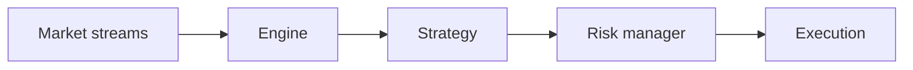
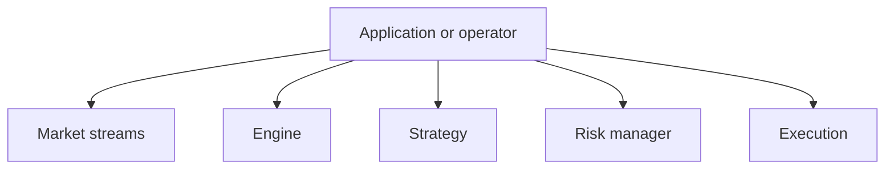
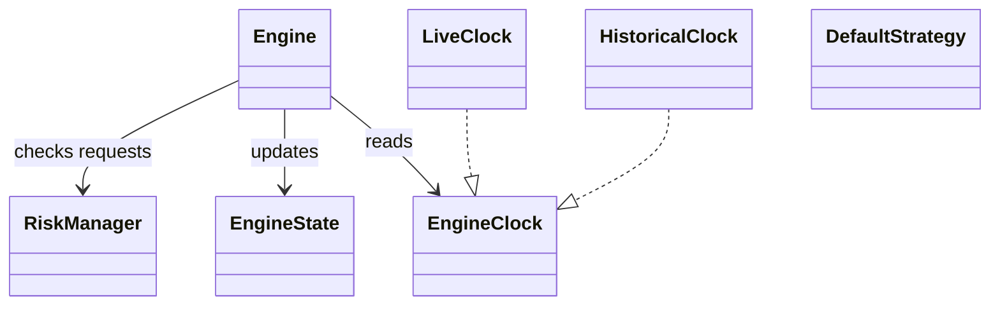
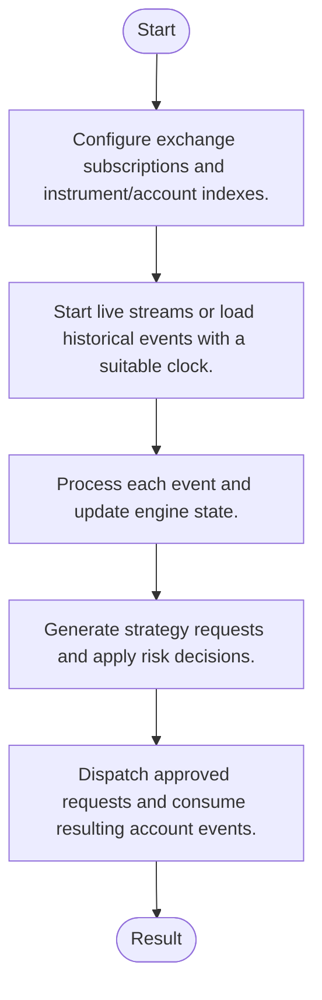
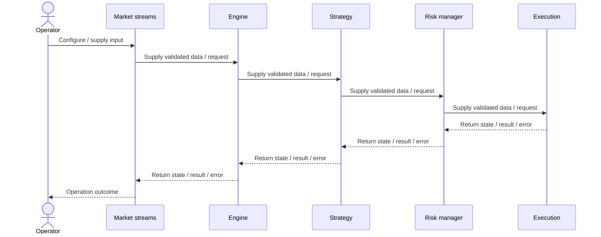
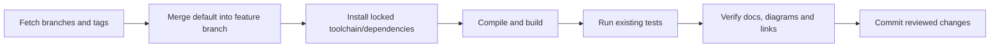

# barter-rs: architecture, features and workflows

Updated: 2026-10-12 · Branch: `feature/ayu_develop` · Source snapshot: `c699d12`

[Development and layout](development.md) · [Validation evidence](validation.md) · [HTML edition](ayu-develop.html)

## Purpose and scope

A Rust framework for event-driven live trading, paper trading and historical simulation. Its engine consumes market/account events, updates indexed state, invokes a strategy and passes requests through a risk manager before dispatching exchange execution.

## Features

- Live and historical clocks separate wall-clock progression from deterministic replay.
- Indexed engine state tracks instruments, accounts and positions.
- Default strategy and risk implementations provide extension points.
- Independent data, execution, instrument, integration and macro crates define package boundaries.
- Venue-specific protocols normalize public market streams and private account updates.

## Components and responsibilities

| Component | Responsibility | Implementation |
| --- | --- | --- |
| Market streams | Normalizes venue subscriptions, trades and order-book updates | [barter-data/src/streams/mod.rs](../barter-data/src/streams/mod.rs) |
| Engine | Processes events and commands against engine state | [barter/src/engine/mod.rs](../barter/src/engine/mod.rs) |
| Strategy | Produces trading decisions through the strategy interfaces | [barter/src/strategy/mod.rs](../barter/src/strategy/mod.rs) |
| Risk manager | Approves or rejects requests before they reach an execution client | [barter/src/risk/mod.rs](../barter/src/risk/mod.rs) |
| Execution | Provides execution requests, client integration and account streams | [barter-execution/src/lib.rs](../barter-execution/src/lib.rs) |

## Architecture and boundaries

The following view shows the principal responsibilities and their data-flow relationship. It is a conceptual architecture view; each implementation link above identifies the owning source. Native or external services retain their own lifecycle and configuration.



### Component ownership

The boundaries below distinguish entry points from their state/model and integration responsibilities. Data validation, numerical semantics and external protocol handling belong in the owning modules rather than in documentation or deployment scripts.



## Types and relationships

This diagram names types present in the linked source. Edges describe the documented relationship; they do not imply additional inheritance.



- [`Engine`](../barter/src/engine/mod.rs)
- [`EngineState`](../barter/src/engine/state/mod.rs)
- [`EngineClock`](../barter/src/engine/clock.rs)
- [`LiveClock`](../barter/src/engine/clock.rs)
- [`HistoricalClock`](../barter/src/engine/clock.rs)
- [`DefaultStrategy`](../barter/src/strategy/mod.rs)
- [`RiskManager`](../barter/src/risk/mod.rs)

## Runtime workflow

1. Configure exchange subscriptions and instrument/account indexes.
2. Start live streams or load historical events with a suitable clock.
3. Process each event and update engine state.
4. Generate strategy requests and apply risk decisions.
5. Dispatch approved requests and consume resulting account events.



## Sequence of a typical operation

This sequence expands the responsibility flow described above. The named participants correspond to the component table; error handling and any service-specific prerequisites remain part of the implementation.



## Development and verification workflow

Sync the upstream refs, merge the actual default branch into `feature/ayu_develop`, resolve conflicts, install the documented environment and run the existing build/test commands. Keep lockfiles and source changes together so another checkout can reproduce the environment.



### Commands

```sh
cargo build --workspace --all-targets --locked
cargo test --workspace --locked
```

The exact commands executed, interpreter/compiler versions, pass/fail counts and any prerequisites are recorded in [validation.md](validation.md). A syntax-only pass is reported separately from a package/native build and from runtime tests.

## Source navigation

These links refer to files in this checkout. They remain useful when the repository is opened locally; the source snapshot above identifies the revision used for this guide.

- [barter-data/src/streams/mod.rs](../barter-data/src/streams/mod.rs)
- [barter/src/engine/mod.rs](../barter/src/engine/mod.rs)
- [barter/src/strategy/mod.rs](../barter/src/strategy/mod.rs)
- [barter/src/risk/mod.rs](../barter/src/risk/mod.rs)
- [barter-execution/src/lib.rs](../barter-execution/src/lib.rs)
- [barter/src/engine/state/mod.rs](../barter/src/engine/state/mod.rs)
- [barter/src/engine/clock.rs](../barter/src/engine/clock.rs)
- [Cargo.toml](../Cargo.toml)
- [barter-data/Cargo.toml](../barter-data/Cargo.toml)
- [barter-data/examples/dynamic_multi_stream_multi_exchange.rs](../barter-data/examples/dynamic_multi_stream_multi_exchange.rs)
- [barter-data/examples/indexed_market_stream.rs](../barter-data/examples/indexed_market_stream.rs)
- [barter-data/examples/multi_stream_multi_exchange.rs](../barter-data/examples/multi_stream_multi_exchange.rs)
- [barter-data/examples/order_books_l1_streams.rs](../barter-data/examples/order_books_l1_streams.rs)
- [barter-data/examples/order_books_l1_streams_multi_exchange.rs](../barter-data/examples/order_books_l1_streams_multi_exchange.rs)
- [barter-data/examples/order_books_l2_manager.rs](../barter-data/examples/order_books_l2_manager.rs)
